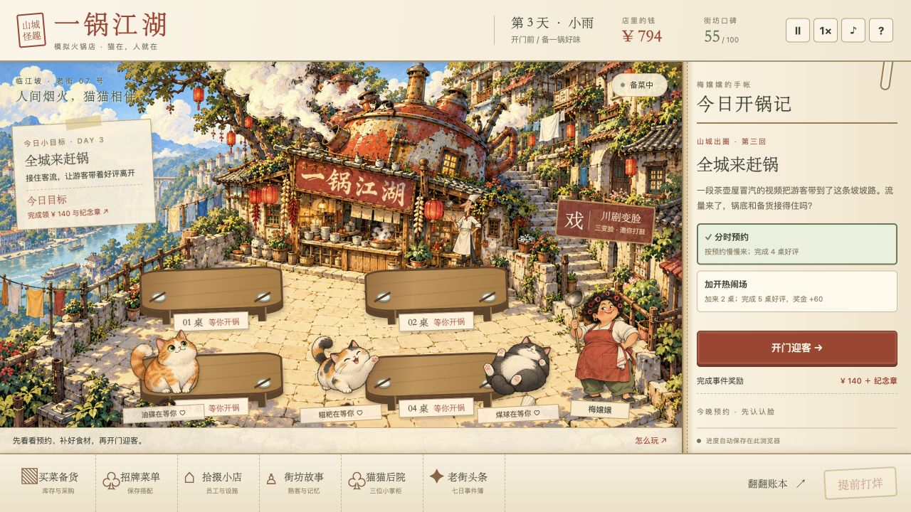

# 模拟火锅店：一锅江湖

山城怪趣 · 七日可玩网页首版。2026-11-01。

包租婆梅嬢嬢在茶壶屋下经营四张桌，三只店猫陪客人吃火锅。读懂一桌人的口味、预算和时间，配锅、安排上菜、看汤味变化；七天后招待一街熟客。

## 开始游戏

**[点击开始游戏](https://zxl9456-hub.github.io/yiguojianghu/)** · 电脑、手机浏览器均可试玩。



所有脚本、美术与音频均随游戏提供，无运行依赖。为正常加载配乐和存档，离线试玩建议在此目录启动本地静态服务：

```sh
python3 -m http.server 4173 --directory dist
```

然后访问 `http://localhost:4173`。存档按浏览器与访问地址隔离，本地版与在线版不会同步。

## 已实现

- 四桌开张，可升级到六桌；八种饭局、八种食材、四种锅底、三种锅型。
- 最多三轮上菜，每轮两盘；菌菇养鲜、肉菜加浓、豆腐土豆吸味。预算、份量、赶时间等都会影响评价。
- 顾客自动涮煮、结账，满意的客人可能加单。亲自收台和员工自动服务。
- 猫咪油碟、糍粑、煤球：可以安排到任意在座客人的桌边。撸猫有冷却与每桌次数限制，增加耐心、评价与亲近度。
- 川剧变脸小游戏：第二天开放，每天一场；在鼓点指针进入绿色区域时亮相，三拍全中获得纪念章。第四天有表演主题事件，热闹堂会与安静雅座的效果不同。
- 七天原创事件，每天两种经营选择；奖励包含金钱、招牌菜单、免费设施、食材和永久服务收益。
- 采购、库存报损、小份菜、套餐保存、跑堂、备菜台、猫软垫、扩桌。
- 熟客记忆、经营账本、可下载小票、纪念章、七日后的继续经营。
- 三段江湖器乐：开张、营业、打烊自动切换；开张与营业使用 Suno v6 原创「老街起锅」江湖快板版，约 126—128 BPM，民乐、贝斯与吉他呼应，已处理循环与响度。
- 开门锣、开锅咕嘟、碗碟、铜钱收账、猫叫呼噜、收台、采购、变脸锣鼓和奖励音效。
- 「江湖留声机」分别调整音乐、音效和环境音；静音记忆、后台停声、变脸时配乐自动让位。
- 暂停、1× / 2× / 3×、移动端布局、本浏览器自动存档。

## 怎么玩

1. 看右侧事件与预约，选择今天的经营方式，再检查菜篮子。
2. 点击「开门迎客」。点击桌子，在右侧选「配锅点单」。打开面板会暂停营业。
3. 看红汤/清汤需求，调整锅型与上菜轮次；预览价格、时间与基础评价，再开锅。
4. 点击桌边猫咪邀请客人撸猫；第二天可邀请变脸师傅登台。
5. 打烊账本会列出收支和问题。第二天开始解锁设施，第三天解锁小份菜，第五天解锁四格锅。

空格键：暂停/继续；变脸时为亮相。1—6：选择桌子。Esc：关闭面板。切换到别的页面会自动暂停，回来点继续。

## 当前制作范围

这是可玩浏览器原型，节奏压缩为每个营业日约 2—4 分钟，加上配餐、购物和表演时间。不是已经完成的 PC 商业发行版本。角色为独立手绘素材叠加动画，暂未制作完整逐帧坐姿、行走寻路和变脸骨骼动画；数值与长期耐玩性仍需要真人试玩调优。

美术：内置 imagegen 生成，参考本项目“山城怪趣 UI v5”。最终提示词见 `美术提示词.md`，四张独立素材在 `dist/assets/`。界面文字与交互都由 HTML/CSS/JavaScript 实现。

新闻灵感与事件设计见 `事件设计与新闻来源.md`。报道年份均注明，不把旧报道描述为最新新闻；真实品牌和当事人未被放入游戏剧情。

## 开发与验证

无安装、无打包步骤。`dist/engine.js` 为可独立测试的模拟规则；`dist/game.js` 为 UI 与输入；`dist/style.css` 为响应式布局；`dist/index.html` 为入口。

```sh
node --check dist/engine.js
node --check dist/game.js
node --check dist/audio.js
node tests/simulation.test.cjs
node tests/audio.test.cjs
```

自动检查覆盖口味取舍、顺序收益、订单原子性、撸猫限制、存读档、变脸奖励、七天完整进程与现金守恒、员工自动接单。

## GitHub Pages 发布

本仓库通过 GitHub Actions 自动检查并发布 `dist/` 到 GitHub Pages。推送到 `main` 后，在仓库的 Actions 页面查看「发布一锅江湖」；检查通过后自动更新在线版本。也可以手动运行 workflow。

修改游戏规则用 `dist/engine.js`，修改界面用 `dist/game.js` 和 `dist/style.css`，替换美术用 `dist/assets/`。提交前运行上方检查命令。无需配置 API 密钥或服务器。

音乐来源、声音设计和 Suno 创作说明见 [音乐与音效](音乐与音效.md)。音乐首次点按后开始播放；点击右上角 ♪ 调整声音。
